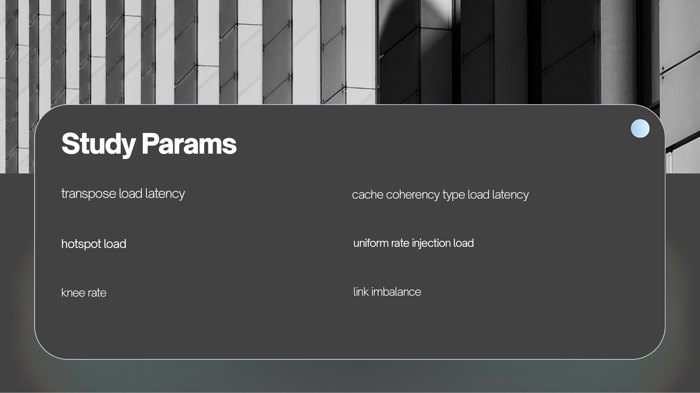
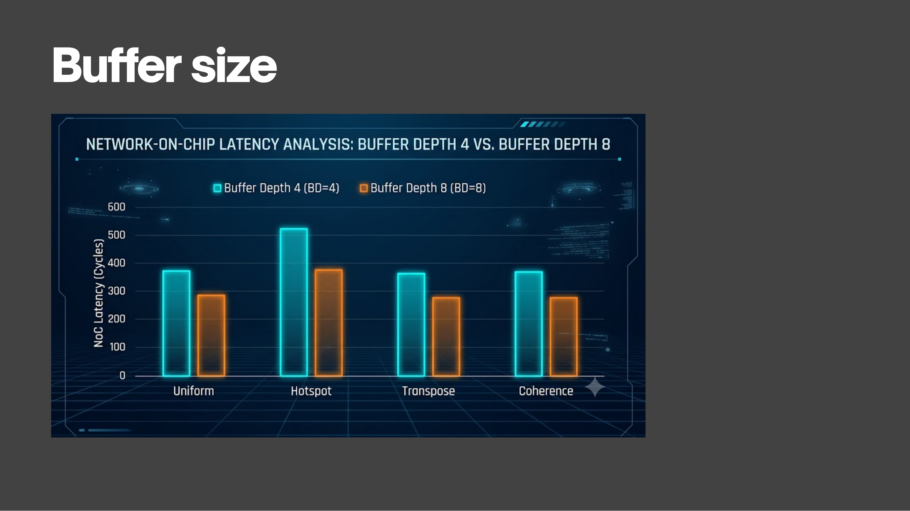
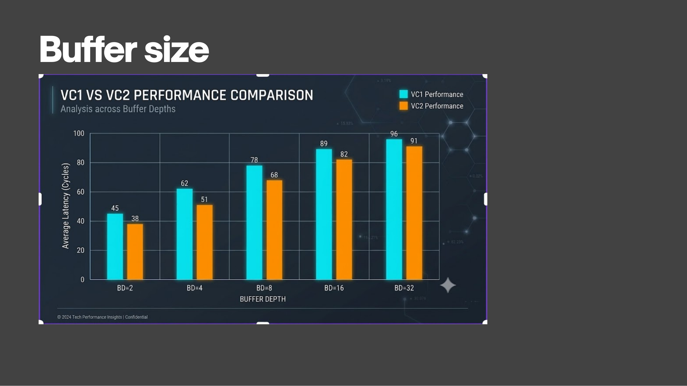
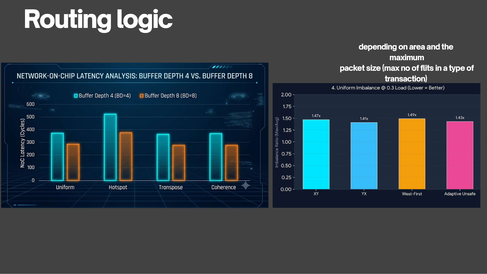

# NOC Param Study

Page-by-page rendering of `NOC PARAM STUDY.pdf` (GitHub's inline PDF preview was unreliable for this file, so pages are embedded as images below).









## Text transcript

```
NOC PARAM STUDY

Study Params
transpose load latency

cache coherency type load latency

hotspot load

uniform rate injection load

knee rate

link imbalance

Buffer size

Buffer size

Routing logic
west first
although performing better
requires
complex logic for routing and
reorder buffers
when set a threshold cycle
tested:
xy guaranteed completion across
all configurations
xy least hw , least complex
routing logic.
and both in west first and
adaptive lot of unnessary hops
are conceded .

Routing logic
depending on area and the
maximum
packet size (max no of flits in a type of
transaction)

Comparison of routing
algorithms

VC per VN

clarifications ..
1. Bus (flit width inter router per output port )width
2.number of flits for various transaction type messages
3.operating frequency(bandwidth requirement )
4.2 vc per vn and 2 VNS ??
5. Communication assist to the Per router input buffer exposing 4 buffers (2 VN * 2 VC)
6.Retry logic ?? flush and let core retry ??
7.security (CRC, Parity in between routers??)

MULTICAST:??

IF MULTICAST::
route computation changes to a bitmask of directions.
And this Multicast msg competes with other normal message - gets vc only
when all the bit directions in th ebitmask has free vc or else gets stalled.
same with sa allocation commit only when all the directions gets the SA.

INC??
extra logic in each home router if data is coming from different routers store in a local buffer
use a local alu compute and provide back to the comm assist.
```

Original file: [`NOC PARAM STUDY.pdf`](NOC%20PARAM%20STUDY.pdf)
